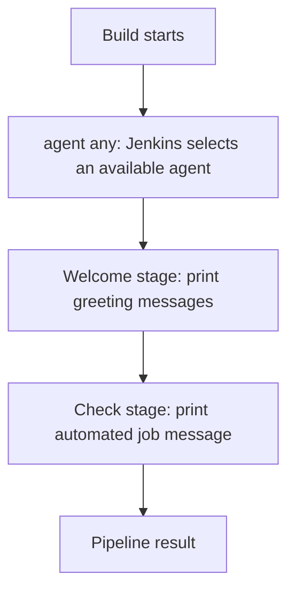
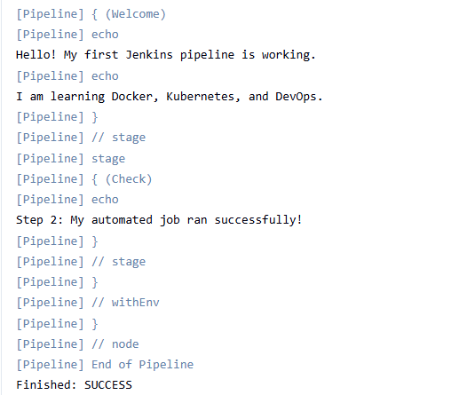

# Jenkins Pipeline Automation Lab

## Project Overview

This project demonstrates introductory Continuous Integration (CI)
skills using Jenkins Pipeline as Code.

The pipeline is stored in a Jenkinsfile and defines automated stages
that print messages to the Jenkins build log.

## Technology Stack

- Jenkins
- Declarative Pipeline
- Groovy-based Jenkinsfile syntax
- Ubuntu Linux
- Git and GitHub

## Pipeline Stages

### Welcome

Prints a message confirming that the pipeline is running.

### Check

Prints a second message to demonstrate sequential pipeline stages.

## How to Use

1. Open Jenkins.
2. Create a Pipeline job or open an existing Pipeline job.
3. Configure the job to use this repository.
4. Select the `Jenkinsfile` from source control.
5. Run the job and review Console Output.

## Learning Objectives

- Understand the structure of a Jenkinsfile.
- Define stages and steps.
- Read Jenkins build logs.
- Version-control pipeline code with Git.
- Prepare for future automated testing and deployment.

## Future Improvements

- Add required-file validation.
- Run Terraform formatting and validation.
- Build and test Docker images.
- Add automated deployment stages.

## Pipeline Workflow Diagram

This diagram represents the two stages defined in the current `Jenkinsfile`. The screenshot below will provide evidence from an actual Jenkins run.

## Successful Pipeline Run

The screenshot below captures the successful Jenkins build and provides evidence of an actual pipeline run.

